<p align="center">
  
  <br>
  <sub>A zoomable, blazing fast, zero dependencies, pure native, typed PDF Renderer for Android and iOS.</sub>
</p>

<p align="center">
  <b>React Native PDF Renderer</b> provides high-performance, dependency-free native PDF rendering for React Native by directly utilizing Android's <a href="https://developer.android.com/reference/android/graphics/pdf/PdfRenderer">PdfRenderer</a> and Apple's <a href="https://developer.apple.com/documentation/pdfkit">PDFKit</a>. Enjoy smooth multi-page scrolling, fluid pinch-to-zoom, thumbnail previews, and comprehensive scale events without the maintenance burden of third-party native binaries.
</p>

<p align="center">
  <a href="LICENSE"></a>
  <a href="https://www.npmjs.com/package/react-native-pdf-renderer"></a>
  <a href="https://www.npmjs.com/package/react-native-pdf-renderer"></a>
  
  =0.71.0-61DAFB?style=flat-square&logo=react&logoColor=black" alt="React Native >= 0.71.0">
  
  <a href="https://github.com/douglasjunior/react-native-pdf-renderer/pulls"></a>
</p>

<p align="center">
  <a href="#-quick-start"><b>Quick Start</b></a> ·
  <a href="#-why-another-pdf-renderer">Why</a> ·
  <a href="#-previews">Previews</a> ·
  <a href="#-requirements">Requirements</a> ·
  <a href="#-installation">Installation</a> ·
  <a href="#-basic-usage">Usage</a> ·
  <a href="#-api-reference">API Reference</a> ·
  <a href="#-limitations--caveats">Limitations</a> ·
  <a href="#-testing-with-jest">Testing</a> ·
  <a href="#-contributing">Contributing</a>
</p>

---

## 🚀 Quick Start

```bash
# 1. Install package
yarn add react-native-pdf-renderer
# or: npm i -S react-native-pdf-renderer

# 2. Install CocoaPods dependencies for iOS
cd ios && pod install
```

```tsx
import React from 'react';
import { SafeAreaView } from 'react-native-safe-area-context';
import PdfRendererView from 'react-native-pdf-renderer';

export default function App() {
  return (
    <SafeAreaView style={{ flex: 1 }}>
      <PdfRendererView
        style={{ flex: 1, backgroundColor: '#000000' }}
        source="file:///path/to/local/file.pdf"
        distanceBetweenPages={16}
        maxZoom={5}
        onPageChange={(current, total) => {
          console.log(`Page: ${current + 1} of ${total}`);
        }}
      />
    </SafeAreaView>
  );
}
```

---

## 💡 Why Another PDF Renderer?

The main reason why this library was created is to **avoid using third-party native dependencies**, such as `com.github.TalbotGooday:AndroidPdfViewer`, `com.github.mhiew:android-pdf-viewer`, `react-native-blob-util`, or `react-native-webview`.

### But why?

Every React Native developer knows (or will discover soon) [the pain of updating the React Native ecosystem](https://x.com/flexbox_/status/1806786055057674337) whenever a new major Android or iOS version comes out. Third-party native wrappers often become abandoned, break during Gradle or Xcode updates, or introduce incompatible native architectures.

Here, we eliminate this friction entirely:

- ⚛️ **Pure Platform Native:** Relies exclusively on official platform SDK engines: [PdfRenderer](https://developer.android.com/reference/android/graphics/pdf/PdfRenderer) on Android and [PDFKit](https://developer.apple.com/documentation/pdfkit) on iOS.
- 🛡️ **Zero Native Bloat:** Zero third-party C++/Java/Obj-C dependencies to link, compile, or debug during React Native upgrades.
- 🔍 **Pinch-to-Zoom & Pan:** Smooth, continuous gesture-based scaling with configurable zoom ceilings and scale tracking.
- 📑 **Single & Multi-Page Modes:** Seamless vertical continuous scroll for multi-page documents, or single-page view for thumbnail covers.
- 🛡️ **OOM & Canvas Crash Prevention:** Built-in `maxPageResolution` safeguards on Android prevent out-of-memory bitmap allocations during deep zooms.
- 📘 **TypeScript Included:** Written in TypeScript with complete prop definitions and IntelliSense documentation.
- 🧪 **Mock Ready:** Pre-configured Jest mock included for painless snapshot and unit testing.

---

## 📸 Previews

| Android | iOS |
|:---:|:---:|
|  |  |

---

## 📋 Requirements

| Platform / Tool | Minimum Version | Notes |
|---|---|---|
| **React Native** | `>= 0.71.0` | Old & New Architecture support |
| **iOS** | `>= 12.0` | Uses native `PDFKit` |
| **Android** | `API 21+` (Android 5.0+) | Uses native `android.graphics.pdf.PdfRenderer` |

---

## 📦 Installation

### 1. Install JavaScript Package

Using yarn:
```bash
yarn add react-native-pdf-renderer
```

Using npm:
```bash
npm i -S react-native-pdf-renderer
```

### 2. iOS CocoaPods Setup

Navigate to your `ios` folder and run `pod install`:

```bash
cd ios && pod install
```

### 3. Android Specific Setup (Optional)

You can customize the [`androidx.recyclerview:recyclerview`](https://developer.android.com/jetpack/androidx/releases/recyclerview) version by configuring `ext` inside your root `android/build.gradle` file (defaults to `1.4.0`):

```gradle
buildscript {
  ext {
    recyclerViewVersion = "1.4.0"
  }
  ...
}
```

---

## 🛠 Basic Usage

There is only one primary component that you need to render PDF documents: `<PdfRendererView />`.

```tsx
import React from 'react';
import { View, StyleSheet } from 'react-native';
import { SafeAreaView } from 'react-native-safe-area-context';
import PdfRendererView from 'react-native-pdf-renderer';

const App = () => {
  return (
    <SafeAreaView style={styles.container}>
      <PdfRendererView
        style={styles.pdf}
        source="file:///path/to/local/file.pdf"
        distanceBetweenPages={16}
        maxZoom={5}
        onPageChange={(current, total) => {
          console.log(`Current page: ${current + 1} / ${total}`);
        }}
        onError={() => {
          console.warn('Failed to load PDF');
        }}
      />
    </SafeAreaView>
  );
};

const styles = StyleSheet.create({
  container: {
    flex: 1,
  },
  pdf: {
    flex: 1,
    backgroundColor: '#1e1e1e',
  },
});

export default App;
```

### 📁 Working with Remote Files

> [!IMPORTANT]
> The `source` prop **must point to a local file stored inside the device's storage** (e.g., `file:///data/user/0/...` or `file:///var/mobile/...`).

If your PDF file is hosted on a remote server, download it to device storage first using a file system library such as [`expo-file-system`](https://docs.expo.dev/versions/latest/sdk/filesystem/) (use `expo-file-system/legacy` on Expo SDK 54+), `react-native-blob-util`, or `rn-fetch-blob`:

```tsx
import React, { useState, useEffect } from 'react';
import { ActivityIndicator, StyleSheet, Text, View } from 'react-native';
// Note: expo-file-system/legacy is used on Expo SDK 54+; earlier SDKs import from 'expo-file-system'
import * as FileSystem from 'expo-file-system/legacy';
import PdfRendererView from 'react-native-pdf-renderer';

export function RemotePdfViewer({ url }: { url: string }) {
  const [localUri, setLocalUri] = useState<string | null>(null);
  const [error, setError] = useState<string | null>(null);

  useEffect(() => {
    let isMounted = true;

    async function downloadPdf() {
      try {
        setError(null);
        const fileUri = `${FileSystem.documentDirectory}document.pdf`;
        const result = await FileSystem.downloadAsync(url, fileUri);
        if (result.status < 200 || result.status >= 300) {
          throw new Error(`Download failed (HTTP ${result.status})`);
        }
        if (isMounted) {
          setLocalUri(result.uri);
        }
      } catch (err) {
        if (isMounted) {
          setError(err instanceof Error ? err.message : 'Failed to download PDF');
        }
      }
    }

    downloadPdf();
    return () => {
      isMounted = false;
    };
  }, [url]);

  if (error) {
    return (
      <View style={styles.center}>
        <Text style={styles.errorText}>{error}</Text>
      </View>
    );
  }

  if (!localUri) {
    return (
      <View style={styles.center}>
        <ActivityIndicator size="large" color="#3fd0ff" />
      </View>
    );
  }

  return (
    <PdfRendererView
      style={{ flex: 1 }}
      source={localUri}
      distanceBetweenPages={16}
      maxZoom={5}
    />
  );
}

const styles = StyleSheet.create({
  center: {
    flex: 1,
    justifyContent: 'center',
    alignItems: 'center',
  },
  errorText: {
    color: '#ef4444',
    fontSize: 14,
  },
});
```

For a comprehensive real-world example featuring scale indicators, full-screen toggles, and modal dialogues, see the [Sample Project](https://github.com/douglasjunior/react-native-pdf-renderer/blob/main/Sample/App.tsx).

---

## 📖 API Reference

### `<PdfRendererView />` Props

| Prop | Type | Default | Description |
|---|---|:---:|---|
| `source` | `string` | — | Path to a local file stored on the device (e.g. `file:///path/to/file.pdf`). |
| `distanceBetweenPages` | `number` | `16` | Vertical spacing in `DPI` between rendered pages. |
| `maxZoom` | `number` | `5` | Maximum allowable zoom scale factor. |
| `maxPageResolution` | `number` | `2048` | *(Android only)* Maximum page resolution (width/height) in pixels when zooming. Designed to prevent Android OOM / Canvas crashes when zooming deeply ([#26](https://github.com/douglasjunior/react-native-pdf-renderer/issues/26)). |
| `singlePage` | `boolean` | `false` | Renders only the first page without scrolling. Ideal for displaying document thumbnails. |
| `onPageChange` | `(current: number, total: number) => void` | — | Callback invoked when the user scrolls between pages. `current` is zero-indexed. |
| `onScaleChange` | `(scale: number) => void` | — | *(Android only)* Invoked continuously while a pinch gesture is in progress. `1` is the unzoomed baseline (fit-to-width in multi-page mode and fit-to-center in `singlePage` mode). Never exceeds `maxZoom`. |
| `onError` | `() => void` | — | Callback invoked when an error occurs while rendering the PDF. |
| `style` | `StyleProp<ViewStyle>` | — | Styles applied to the native view container. *(Note: border radius is not directly supported; see [Limitations](#border-radius)).* |
| `testID` | `string` | — | Optional identifier used to locate this view in automated end-to-end testing. |

---

## ⚠ Limitations & Caveats

### Page Interactions

Because Android renders PDF pages as full bitmap images via `android.graphics.pdf.PdfRenderer`, native text selection, screen reader accessibility for PDF contents, and hyperlink clicks within the PDF are not supported on Android.

> [!TIP]
> If text selection or interactive document links are critical for your use case, we recommend adding an action button to open the PDF in the platform's external system viewer.

### Size Measuring

`PdfRendererView` has `flex: 1` applied by default. Ensure that parent containers either have `flex: 1` or explicitly defined dimensions (`width` and `height`).

### Border Radius

The `borderRadius` style property is ignored by React Native custom views on Android and can cause native crashes on iOS (read more in issue [#1](https://github.com/douglasjunior/react-native-pdf-renderer/issues/1#issuecomment-1483395465)).

If you need rounded corners, wrap `<PdfRendererView />` inside a container `View` with clipping:

```tsx
<View style={{ flex: 1, borderRadius: 24, overflow: 'hidden' }}>
  <PdfRendererView
    style={{ flex: 1 }}
    source="file:///path/to/file.pdf"
  />
</View>
```

### Android Crash When Zooming Too Much

To protect Android devices from out-of-memory crashes when zooming into large documents, use the `maxPageResolution` prop.

> [!WARNING]
> If you encounter `java.lang.RuntimeException: Canvas: trying to draw too large(134806560bytes) bitmap`, reduce `maxPageResolution` (e.g. to `1536` or `1024`). Refer to [Issue #26](https://github.com/douglasjunior/react-native-pdf-renderer/issues/26) for details.

---

## 🧪 Testing with Jest

The library bundles a pre-configured mock view to ensure your test suites run smoothly:

```js
// jest.setup.js or in your test file
jest.mock('react-native-pdf-renderer', () => require('react-native-pdf-renderer/dist/mock'));
```

---

## 🤝 Contributing

Contributions, bug reports, and pull requests are warmly welcome!

1. Fork the repository and create your branch from `main`.
2. Ensure code compiles and adheres to linting rules.
3. Open a pull request explaining your changes and motivation.

For questions, discussions, or feature suggestions, please check out the [Issues](https://github.com/douglasjunior/react-native-pdf-renderer/issues) page.

### Support the Author

If this library saved you time or solved your PDF rendering challenges, consider supporting the maintainer:

<p align="left">
  <a href="https://www.patreon.com/douglasjunior"></a>
  &nbsp;
  <a href="https://paypal.me/douglasnassif"></a>
</p>

---

## 🙏 Thanks to

This library is possible thanks to valuable contributions and solutions from the community:

- [RecyclerView `notifyDataSetChanged()` not working on React Native](https://stackoverflow.com/a/49381907/2826279)
- [Add pinch to zoom on RecyclerView](https://stackoverflow.com/a/37895783/2826279)
- [Using `Matrix` to handle zoom in a View](https://stackoverflow.com/a/55299327/2826279)
- [Daniel Felipe Sartório](https://github.com/danielfelipesartorio) for native Android code assistance

---

## ⭐ Star History

<p align="center">
  <a href="https://star-history.com/#douglasjunior/react-native-pdf-renderer&Date">
    <picture>
      <source media="(prefers-color-scheme: dark)" srcset="https://api.star-history.com/svg?repos=douglasjunior/react-native-pdf-renderer&type=Date&theme=dark" />
      
    </picture>
  </a>
</p>

---

## 📄 License

```text
The MIT License (MIT)

Copyright (c) 2023 Douglas Nassif Roma Junior
```

See the full [license file](LICENSE).

---

## 🌐 Author & More Projects

<p align="center">
  <a href="https://douglasjunior.work">
    
  </a>
</p>

<p align="center">
  Discover more open-source libraries, creative animation engines, and developer tools at <a href="https://douglasjunior.work"><b>douglasjunior.work</b></a>.
</p>
